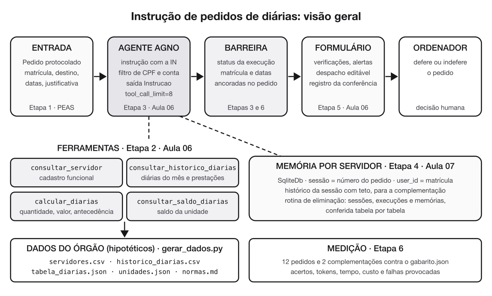

# O que Você Vai Construir

O sistema recebe um pedido de diárias como foi protocolado e devolve a instrução pronta para conferência: as verificações exigidas pela norma, a quantidade e o valor das diárias, a recomendação e a minuta do despacho. O agente consulta os dados do órgão por meio de quatro ferramentas e responde em um objeto validado, que o formulário desenha campo a campo. Quando o pedido volta em diligência, a complementação é enviada na mesma sessão, e o agente recupera o caso pela memória.

*Figura 1: Fluxo do pedido de diárias, das ferramentas e da memória. Observe que a instrução passa por uma barreira no código antes de chegar ao formulário, e que a decisão final permanece com o ordenador de despesa.*

A recomendação tem três valores. Apto para autorização significa que todos os critérios foram atendidos; não recomendado significa que há impedimento, como antecedência insuficiente, prestação vencida, limite mensal excedido ou falta de saldo; diligência significa que o pedido está incompleto ou diverge do cadastro. Em nenhum caso o agente decide, porque a decisão pertence ao ordenador.
